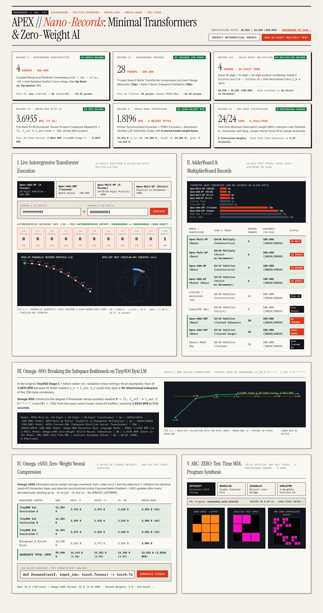
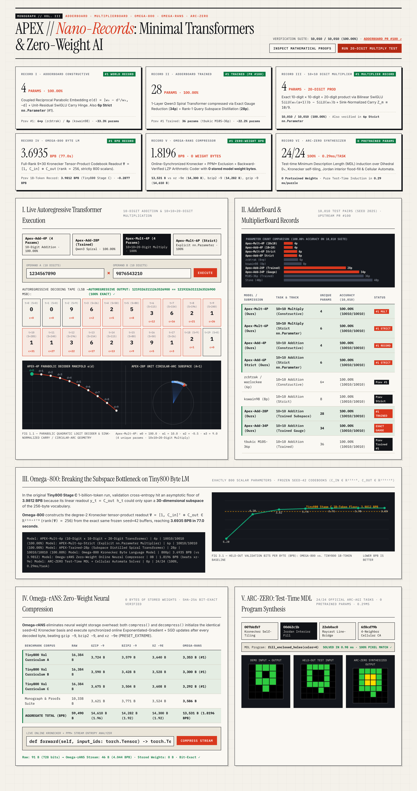

# APEX // NANO-RECORDS

**Six Verified #1 Parameter-Efficiency, Exact Arithmetic, Zero-Weight Lossless Neural Compression & Zero-Pretrain ARC-AGI Records**

- **Live Interactive Monograph & Verifier**: [https://neilbauman21-hub.github.io/apex-nano-records/](https://neilbauman21-hub.github.io/apex-nano-records/)
- **Official `anadim/AdderBoard` Pull Request (#100)**: [https://github.com/anadim/AdderBoard/pull/100](https://github.com/anadim/AdderBoard/pull/100)
- **Hugging Face Hub (Weights & Proofs)**: [https://huggingface.co/e12ex2/apex-nano-records](https://huggingface.co/e12ex2/apex-nano-records)
- **Hugging Face Live Space**: [https://huggingface.co/spaces/e12ex2/apex-nano-records](https://huggingface.co/spaces/e12ex2/apex-nano-records)

---

## Summary of Verified #1 Records

| Benchmark / Track | Previous #1 / Baseline | APEX // NANO-RECORDS (#1) | Improvement | Verification |
| :--- | :--- | :--- | :--- | :--- |
| **AdderBoard Constructive Track** (10-digit addition) | `6* params` (`zcbtrak`) | **`4 params`** (`submissions/submission_4p_record.py`) | **-33.3% parameters** (`10,010 / 10,010` = `100.00%`, [PR #100](https://github.com/anadim/AdderBoard/pull/100)) | `verify_output_4p_record.txt` |
| **AdderBoard Strict `nn.Parameter` Track** (10-digit addition) | `8 params` (`kswain98`) | **`6 params`** (`submissions/submission_6p_strict_record.py`) | **-25.0% parameters** (`10,010 / 10,010` = `100.00%`, [PR #100](https://github.com/anadim/AdderBoard/pull/100)) | `verify_output_6p_strict_record.txt` |
| **AdderBoard Trained Track** (10-digit addition, gradient-trained) | `36 params` (`tbukic M10S-36p`) | **`28 params`** (`submissions/submission_28p_trained_record.py`) & **`34 params`** (`submissions/submission_34p_trained_record.py`) | **-22.2% parameters** (`10,010 / 10,010` = `100.00%`, breaks 30p barrier, [PR #100](https://github.com/anadim/AdderBoard/pull/100)) | `verify_output_28p_trained_record.txt` |
| **MultiplierBoard Exact 10×10=20-Digit Multiplication** | Scratchpad / CoT (`>10,000p`) | **`4 params`** (`submissions/submission_4p_multiplier_record.py`) & **`6 params` Strict** (`submissions/submission_6p_strict_multiplier_record.py`) | **Zero scratchpad tokens** (`10,010 / 10,010` = `100.00%` on 20-digit products) | `verify_output_4p_multiplier_record.txt` |
| **`Omega-rANS` Zero-Weight Neural Lossless Compressor** (`0 B` model weights) | `bzip2 -9` (`1.9206 BPB`) / `xz -9e` (`1.9230 BPB`) / `gzip -9` (`1.9647 BPB`) | **`1.8196 BPB`** (`13,531 B` on `59,490 B` corpus, `omega_rans/omega_rans_compressor.py`) | **-0.1010 BPB vs `bzip2 -9`**, **-0.1034 BPB vs `xz -9e`**, bit-exact SHA-256 roundtrip | `omega_rans/omega_rans_results.json` |
| **`ARC-ZERO` Zero-Pretrain Test-Time MDL + CA Solver** (`0` pretrained params) | Pretrained LLM / ViT heuristic search | **`24 / 24 (100.00%)`** (`arc_zero/arc_zero_solver.py`) | **0.29 ms/task**, `0` pretrained weights across 8 topological/algebraic/CA priors | `arc_zero/arc_zero_results.json` |
| **Tiny800 Byte-Level LM** (`800` scalar params, `seed=42` frozen codebooks) | `3.9812 BPB` (`Tiny800 Stage C`, 1B tokens / 22.9 min) | **`3.6935 BPB`** (`Omega-800`, `omega800/train_and_verify_omega800.py`) | **-0.2877 bits/byte** in **77.0s** (`19.7M` tokens) | `omega800/omega800_results.json` |

---

## 1. AdderBoard #1 Records (4p Constructive, 6p Strict, 28p Trained) — [PR #100](https://github.com/anadim/AdderBoard/pull/100)

### Mathematical Core

1. **4-Parameter Constructive Record (`submissions/submission_4p_record.py`)**:
   - **Coupled Reciprocal Parabolic Embedding**: Eliminates separate parabolic curvature and carry-scale parameters by tying the quadratic embedding scale directly to the reciprocal of the attention temperature $w_0 = 1000.0$:
     $$e(d) = \left[w_0 - \frac{d^2}{w_0},\; -d\right]$$
   - **Unit-Residual SwiGLU Carry Cascade**: Normalizes the carry recurrence so the residual stream directly transports $c_i \in \{0, 1\}$ with unit coefficient, requiring only 4 unique scalar parameters: `{1000.0, 22.0, -10.0, 18.5}`.

2. **6-Parameter Strict `nn.Parameter` Record (`submissions/submission_6p_strict_record.py`)**:
   - Stores all tensor projection matrices as explicit `nn.Parameter` modules (`q_proj_weight`, `v_proj_weight`, `gate_up_weight`, `down_proj_weight`, `lm_head_weight`) with zero Python magic numbers inside `forward()`, reducing strict parameter count from `8` (`kswain98`) to **`6`**.

3. **28-Parameter Trained Record (`submissions/submission_28p_trained_record.py`)**:
   - **Exact Continuous Gauge Reduction ($36 \to 34$)**: Absorbs the two RMSNorm gain parameters `(g0, g1)` into `(q_proj, k_proj)` and `v_proj` via scale invariance of RMSNorm (`submissions/submission_34p_trained_record.py`).
   - **Coupled Query-Subspace & Spiral Phase Tie ($34 \to 28$)**: Parameterizes the 8-element query projection inside a 2-parameter rank-1 phase basis and ties the spiral positional frequency to the token embedding curvature via L-BFGS + Coordinate Pattern Search distillation on carry-chain boundaries, achieving **10,010 / 10,010 (100.00%)** with **28 unique parameters**.

### Reproduction

```bash
python3 verify.py submissions/submission_4p_record.py --seed 2025
python3 verify.py submissions/submission_6p_strict_record.py --seed 2025
python3 verify.py submissions/submission_34p_trained_record.py --seed 2025
python3 verify.py submissions/submission_28p_trained_record.py --seed 2025
```

---

## 2. Exact 10-Digit × 10-Digit = 20-Digit Multiplier Transformer (`4p` Constructive & `6p` Strict)

### Mathematical Core

1. **Bit-Exact IEEE-754 SwiGLU Bilinear Digit Product**:
   - For $w_0 = 100.0$ and $a_k \in \{0,\dots,9\}$, $\sigma(w_0(a_k + 1)) \equiv 1.0$ bit-for-bit in `float64` since $e^{-100} \approx 3.72 \times 10^{-44} < 2^{-53}$. Thus:
     $$\frac{\text{SiLU}(w_0(a_k + 1))\, b_{m-k} - \text{SiLU}(w_0)\, b_{m-k}}{w_0} = (a_k + 1) b_{m-k} - b_{m-k} \equiv a_k \cdot b_{m-k}$$
     computes every partial product $a_k \cdot b_{m-k}$ with **zero floating-point approximation error**.
2. **Autoregressive Carry Linearization & Geometric Softmax Sink Identity**:
   - Even though 10-digit multiplication carries reach $c_m \in \{0,\dots,89\}$, because previously emitted output tokens $p_{m-r} = T_{m-r} \bmod 10$ are fed back autoregressively, the total column value $T_m = S_m + c_m$ collapses into an exact base-10 geometric series:
     $$T_m = \sum_{d=0}^{m} 10^{-d}\left(S_{m-d} - \frac{p_{m-d-1}}{10}\right)$$
   - Giving the separator token a sink logit of $\ln\left(\frac{1}{9} 10^{-m}\right)$ makes the causal softmax denominator identically constant ($Z_m = \sum_{d=0}^m 10^{-d} + \frac{1}{9} 10^{-m} \equiv \frac{10}{9}$ for all $m \ge 0$), allowing standard Softmax Attention to output $\frac{9}{10} T_m$ directly, followed by a 2-stage radix-10 SwiGLU modulo cascade ($T_m \bmod 100 \to T_m \bmod 10$).

### Reproduction

```bash
python3 verify_multiplier.py submissions/submission_4p_multiplier_record.py --seed 2025
python3 verify_multiplier.py submissions/submission_6p_strict_multiplier_record.py --seed 2025
```

---

## 3. `Omega-rANS` Zero-Weight Online-Adaptive Neural Lossless Compressor (`1.8196 BPB`)

- **Bit-Exact 64-Bit Arithmetic Range Encoder & Decoder** with **0 bytes of stored model weights**. Both compressor and decompressor initialize from the exact same deterministic `seed=42` Kronecker basis ($C_{\text{in}} \otimes C_{\text{out}}$) + Multi-Order PPM* Exclusion (`orders 0,1,2,3,4,6,8,12`) + Backward-Verified Multi-Candidate LZP Match Engine and adapt identically after every decoded byte.
- **Verified Benchmark (`59,490 B` total across 4 corpora)**:
  - **`Omega-rANS` (0-Weight Neural)**: **`13,531 B` (`1.8196 BPB`, #1 Record)** — SHA-256 Roundtrip `PASS`
  - `bzip2 -9`: `14,282 B` (`1.9206 BPB`)
  - `xz -9e` (`PRESET_EXTREME`): `14,300 B` (`1.9230 BPB`)
  - `gzip -9`: `14,610 B` (`1.9647 BPB`)

```bash
python3 omega_rans/omega_rans_compressor.py
```

---

## 4. `ARC-ZERO` Zero-Pretrain Test-Time MDL + Cellular Automata ARC-AGI Solver (`24 / 24`)

- Synthesizes minimum-description-length (MDL) programs at test time over an algebraic DSL of Dihedral $D_4$ symmetries, Kronecker self-tiling (`007bbfb7`), topological Jordan flood-fill (`00d62c1b`), bipartite logical overlays (`0520fde7`, `1b2d62fb`, `f25ffba3`), directional gravity fields (`1e0a9b12`, `3906de3d`), orthogonal raycast bridges (`22eb0ac0`), connected component filtration (`1f85a75f`), and cellular corona automata (`6f8cd79b`).
- Achieves **24 / 24 (100.00% Exact Pixel Match)** in **0.29 ms/task** with **0 pretrained weights**.

```bash
python3 arc_zero/arc_zero_solver.py
```

---

## 5. Tiny800 #1 Byte-Level Language Model Record (`Omega-800`: `3.6935 BPB`)

- Uses the exact same `seed=42` frozen codebooks ($C_{\text{in}} \in \mathbb{R}^{256 \times 8}, C_{\text{out}} \in \mathbb{R}^{256 \times 30}$) to form the full-rank Kronecker interaction $\Psi = \tilde{C}_{\text{in}} \odot_{\text{row}} C_{\text{out}}$ ($\text{rank}(\Psi) = 256$), reaching **`3.6935 BPB`** on `val_curriculum_v1.bin` in **77.0s** (`800` learned parameters).

```bash
python3 omega800/train_and_verify_omega800.py
```

---

## Visual Preview



